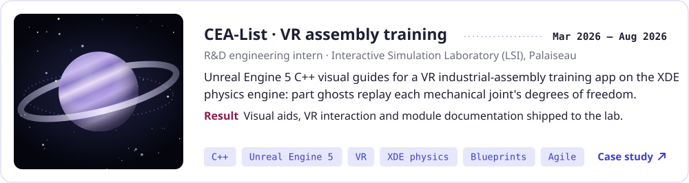
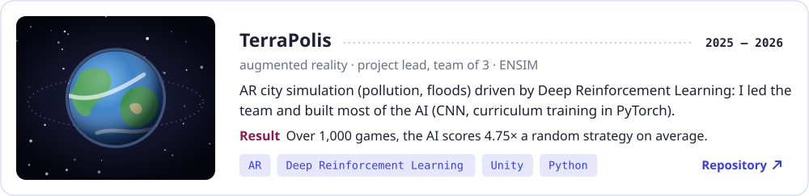
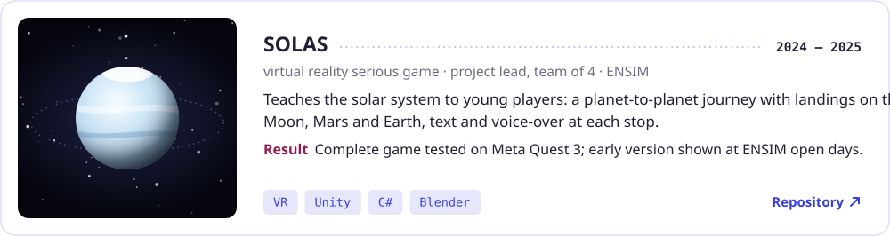
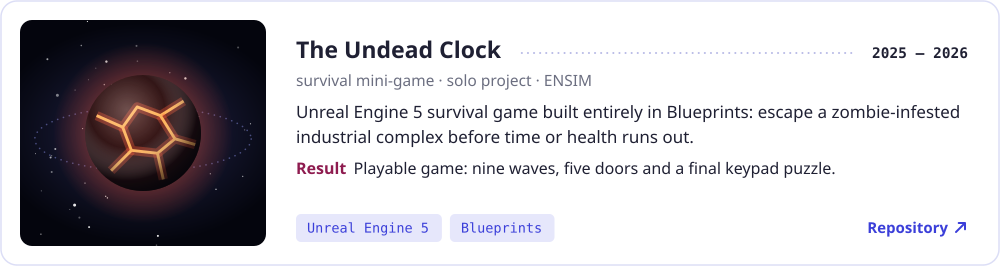
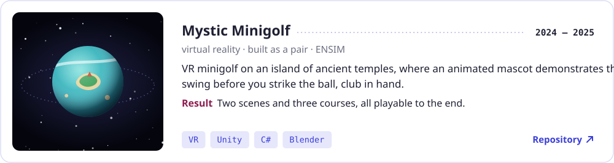
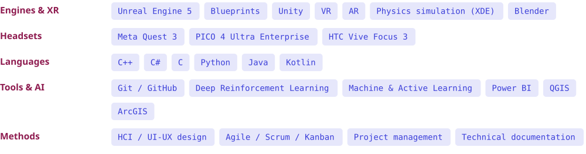

  <a href="https://thibautplatet.com/assets/cv/CV_Thibaut_Platet_EN.pdf"><picture><source media="(prefers-color-scheme: dark)" srcset="assets/btn-cv-dark.svg"><source media="(prefers-color-scheme: light)" srcset="assets/btn-cv-light.svg"></picture></a>
  <a href="https://thibautplatet.com/en/"><picture><source media="(prefers-color-scheme: dark)" srcset="assets/btn-portfolio-dark.svg"><source media="(prefers-color-scheme: light)" srcset="assets/btn-portfolio-light.svg"></picture></a>
  <a href="https://www.linkedin.com/in/thibaut-platet-547b03275/"><picture><source media="(prefers-color-scheme: dark)" srcset="assets/btn-linkedin-dark.svg"><source media="(prefers-color-scheme: light)" srcset="assets/btn-linkedin-light.svg"></picture></a>
  <a href="mailto:contact@thibautplatet.com"><picture><source media="(prefers-color-scheme: dark)" srcset="assets/btn-email-dark.svg"><source media="(prefers-color-scheme: light)" srcset="assets/btn-email-light.svg"></picture></a>

<h3><picture><source media="(prefers-color-scheme: dark)" srcset="assets/h-profile-dark.svg"><source media="(prefers-color-scheme: light)" srcset="assets/h-profile-light.svg"></picture></h3>

I build virtual reality and simulation applications. At **CEA-List**, a French public research institute, I spent six months working in **Unreal Engine 5 C++** on a VR training application for industrial assembly, where I developed the visual guides that show operators how a part fits together before they handle it. Coming from a humanities and social sciences preparatory class and a degree in geography, I design every simulation around the person who will use it.

**Open to:** XR, simulation and real-time 3D engineering roles (Unreal Engine, Unity), permanent or fixed-term, in France or abroad.

<h3><picture><source media="(prefers-color-scheme: dark)" srcset="assets/h-work-dark.svg"><source media="(prefers-color-scheme: light)" srcset="assets/h-work-light.svg"></picture></h3>

<a href="https://thibautplatet.com/en/projects/cea-list.html"><picture><source media="(prefers-color-scheme: dark)" srcset="assets/card-cea-list-dark.svg"><source media="(prefers-color-scheme: light)" srcset="assets/card-cea-list-light.svg"></picture></a>

▶ <a href="https://www.youtube.com/watch?v=AWou4s9IaSg">Project video</a> · <a href="https://www.youtube.com/watch?v=PMIZ1R9MNpg">Mechanical joints demo</a> · <a href="https://www.youtube.com/watch?v=etRPNNXaRo4">Starting locations and reassignment demo</a>

<a href="https://github.com/ThibPltt/Terrapolis"><picture><source media="(prefers-color-scheme: dark)" srcset="assets/card-terrapolis-dark.svg"><source media="(prefers-color-scheme: light)" srcset="assets/card-terrapolis-light.svg"></picture></a>

▶ <a href="https://www.youtube.com/watch?v=86Q1wE_7Ecg">Project video</a> · <a href="https://www.youtube.com/watch?v=sdau2TpGC24">The AI plays a full game</a> · <a href="https://github.com/ThibPltt/Terrapolis">Project hub</a>

<a href="https://github.com/ThibPltt/SOLAS"><picture><source media="(prefers-color-scheme: dark)" srcset="assets/card-solas-dark.svg"><source media="(prefers-color-scheme: light)" srcset="assets/card-solas-light.svg"></picture></a>

▶ <a href="https://www.youtube.com/watch?v=2curbw4u178">Gameplay video</a>

<a href="https://github.com/ThibPltt/The-Undead-Clock"><picture><source media="(prefers-color-scheme: dark)" srcset="assets/card-the-undead-clock-dark.svg"><source media="(prefers-color-scheme: light)" srcset="assets/card-the-undead-clock-light.svg"></picture></a>

▶ <a href="https://www.youtube.com/watch?v=hAo6v7G74Nc">Gameplay video</a>

<a href="https://github.com/ThibPltt/Mystic_MiniGolf_VR"><picture><source media="(prefers-color-scheme: dark)" srcset="assets/card-mystic-minigolf-dark.svg"><source media="(prefers-color-scheme: light)" srcset="assets/card-mystic-minigolf-light.svg"></picture></a>

▶ <a href="https://github.com/ThibPltt/Mystic_MiniGolf_VR/releases/latest">Download v1.0 (PC VR build)</a>

<h3><picture><source media="(prefers-color-scheme: dark)" srcset="assets/h-more-dark.svg"><source media="(prefers-color-scheme: light)" srcset="assets/h-more-light.svg"></picture></h3>

- **[ARmageddon](https://github.com/ThibPltt/ARmageddon)** · AR battlefield sandbox for Android: scan the room, sculpt the terrain, place troops and buildings. *Unity, AR Foundation, C#.*
- **[Active Learning](https://github.com/ThibPltt/ActiveLearning)** · Webcam gaze tracking with ResNet-18: active learning strategies compared to label as few new images as possible. *Python, PyTorch, Hugging Face Transformers.*
- **[Shepherding](https://github.com/ThibPltt/Shepherding)** · Reinforcement learning on a herding task: PPO, DQN, SAC and TD3 against scripted baselines, with curriculum learning. *Python, PyTorch, Stable-Baselines3.*
- **[Vert le Chemin](https://github.com/ThibPltt/-Vert-le-chemin)** · Android app that estimates the CO₂ of daily trips from ADEME data and suggests greener means of transport. *Kotlin, Jetpack Compose, Firebase.*

<h3><picture><source media="(prefers-color-scheme: dark)" srcset="assets/h-skills-dark.svg"><source media="(prefers-color-scheme: light)" srcset="assets/h-skills-light.svg"></picture></h3>

<picture><source media="(prefers-color-scheme: dark)" srcset="assets/skills-dark.svg"><source media="(prefers-color-scheme: light)" srcset="assets/skills-light.svg"></picture>

<h3><picture><source media="(prefers-color-scheme: dark)" srcset="assets/h-background-dark.svg"><source media="(prefers-color-scheme: light)" srcset="assets/h-background-light.svg"></picture></h3>

<picture><source media="(prefers-color-scheme: dark)" srcset="assets/background-dark.svg"><source media="(prefers-color-scheme: light)" srcset="assets/background-light.svg"></picture>

**Languages:** French (native) · English B2 (TOEIC 815/990)

---

🇫🇷 Version française du portfolio : <a href="https://thibautplatet.com/">thibautplatet.com</a> · Visual identity from the portfolio, images generated by <a href="_build/gen.py"><code>_build/gen.py</code></a>
